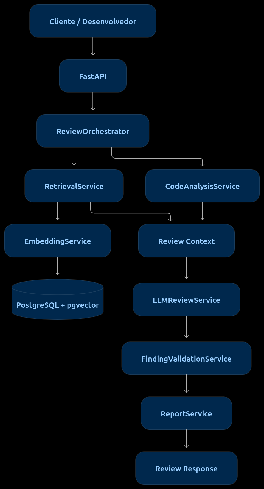

# Arquitetura e responsabilidades

[Voltar ao índice](../../AGENTS.md)

A arquitetura será organizada em camadas, utilizando Service Objects para encapsular operações específicas do sistema.

## Arquitetura proposta

## Responsabilidade de cada camada

| Camada | Responsabilidade |
| --- | --- |
| API | Receber requisições HTTP |
| Schemas | Validar contratos de entrada e saída |
| Domain | Representar entidades e regras centrais |
| Services | Executar operações de negócio |
| Repositories | Encapsular persistência |
| Integrations | Comunicação com APIs externas |
| Core | Configurações, exceções e componentes compartilhados |
| Tests | Validar comportamento e qualidade |
