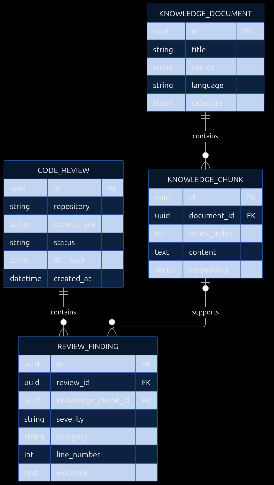

# Modelo de dados conceitual

[Voltar ao índice](../../AGENTS.md)

A princípio, teremos quatro entidades principais:

<table>
  <tr>
    <td>
      <strong>CodeReview</strong>
      
Representa uma revisão realizada.

      
ID, repository, commit_sha, status, diff_hash, created_at

    </td>
  </tr>
  <tr>
    <td>
      <strong>ReviewFinding</strong>
      
Representa um problema identificado.

      
ID, review_id, title, severity, category, evidence, recommendation, line_number

    </td>
  </tr>
  <tr>
    <td>
      <strong>KnowledgeDocument</strong>
      
Representa um documento técnico ingerido.

      
ID, title, source, language, category, version, content_hash

    </td>
  </tr>
  <tr>
    <td>
      <strong>KnowledgeChunk</strong>
      
Representa um fragmento de documento com seu embedding.

      
ID, document_id, content, chunk_index, embedding, metadata

    </td>
  </tr>
</table>

Relacionamentos principais:

Uma decisão importante: para o MVP educacional, podemos persistir inicialmente apenas a base de conhecimento e os fragmentos. O histórico completo das revisões pode ser implementado depois, caso o objetivo de aprendizagem exija essa persistência.
