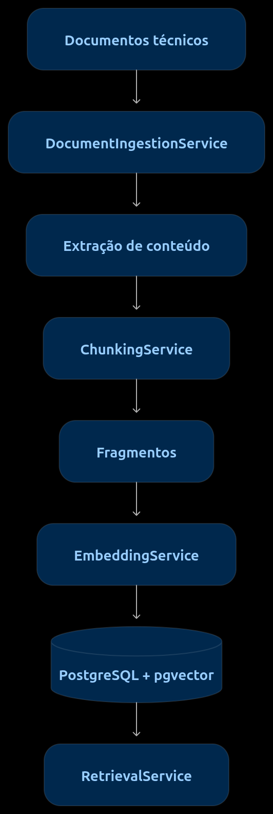

# Pipeline de ingestão

[Voltar ao índice](../../AGENTS.md)



Cada fragmento deve possuir metadados como:

```json
{
  "source": "OWASP",
  "category": "security",
  "language": "python",
  "title": "SQL Injection Prevention",
  "version": "referência registrada",
  "chunk_index": 1
}
```
