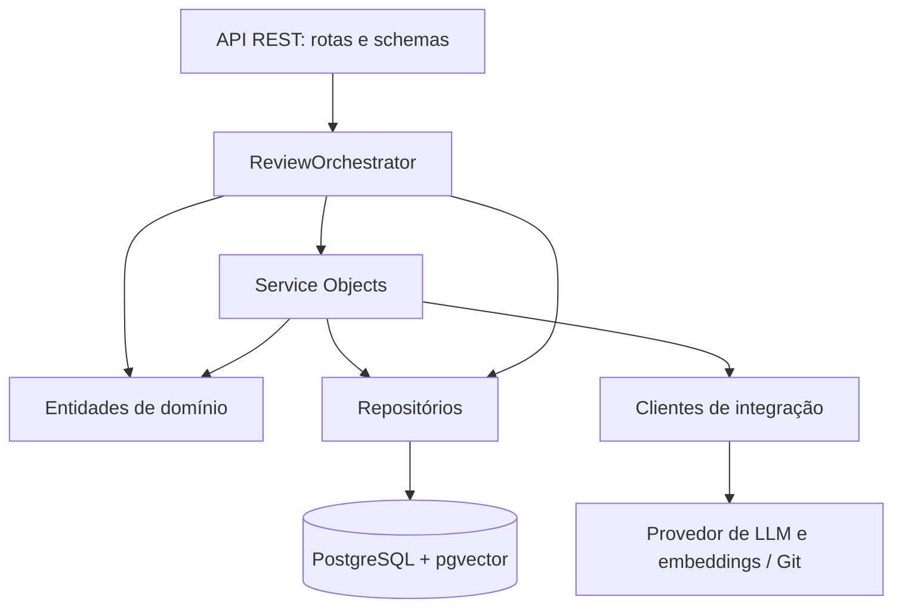
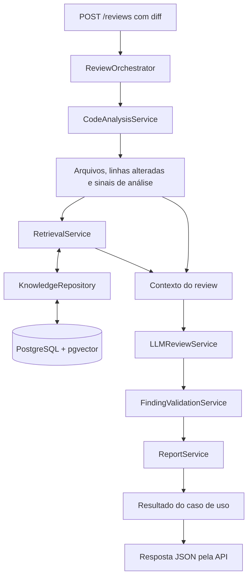
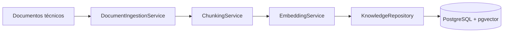
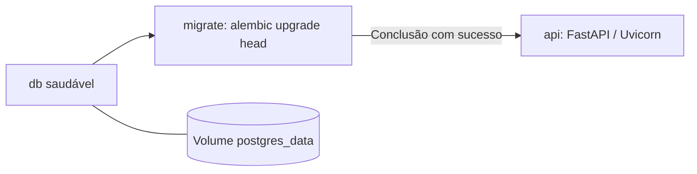

# Arquitetura — Code Review Inteligente

Este documento registra a arquitetura definida para o assistente de code review com Python, RAG e Service Objects. Descreve tanto a direção do projeto quanto seu estágio atual; componentes planejados não devem ser interpretados como funcionalidades disponíveis.

## 1. Objetivo e escopo

Analisar alterações de código, recuperar boas práticas de uma base de conhecimento e produzir apontamentos com localização, justificativa técnica e referências. O sistema deve permitir avaliar a qualidade das sugestões e rastrear os documentos usados como fundamento.

A primeira interface de negócio será uma API REST que recebe um diff Git. Posteriormente, a integração com GitHub poderá acionar o mesmo caso de uso para revisar Pull Requests. A ingestão de documentos técnicos será um fluxo separado da execução de reviews.

O desenvolvimento será incremental, em pair programming, priorizando compreensão das decisões, separação de responsabilidades e testes.

## 2. Estágio atual

| Área | Implementado no repositório | Próxima evolução |
| --- | --- | --- |
| Infraestrutura | Docker, Compose base e de desenvolvimento, Python 3.12 e PostgreSQL 17 com pgvector | Adequar a configuração ao ambiente de implantação |
| API | FastAPI com liveness e readiness | Criar a rota de reviews e seus schemas |
| Banco | Engine e sessões assíncronas com SQLAlchemy 2 e asyncpg | Introduzir repositórios e modelos do negócio |
| Migrações | Alembic assíncrono e revisão `0001`, que habilita `vector` e cria `documents` | Criar tabelas de conhecimento e reviews conforme os contratos |
| Domínio | `Severity` e estrutura inicial da dataclass `ReviewFinding` | Validar apontamentos e definir `CodeReview` |
| RAG e LLM | Ainda não implementados | Ingestão, embeddings, recuperação e geração estruturada |
| Testes | `tests/smoke.py`, com HTTP e operações vetoriais pelo ORM | Testes unitários, de integração e avaliação |
| GitHub | Ainda não implementado | Integração após estabilizar o fluxo REST |

Atualmente não existem `POST /reviews`, execução de LLM ou geração de embeddings. A tabela `documents` é um exemplo de infraestrutura com vetores de três dimensões, não o modelo definitivo da base de conhecimento.

## 3. Organização e dependências

A aplicação será organizada como um monólito modular. Os Service Objects serão classes com operações específicas dentro da mesma aplicação; não exigem containers ou processos separados.



As setas representam uso entre componentes. Os serviços recebem seus colaboradores por injeção de dependências, permitindo substituí-los em testes.

- **API:** valida o contrato HTTP, chama o caso de uso e converte o resultado para a resposta.
- **Domínio:** representa conceitos e invariantes do negócio sem importar FastAPI, SQLAlchemy ou SDKs de fornecedores.
- **Serviços:** executam operações do caso de uso e utilizam entidades, repositórios e clientes.
- **Repositórios:** encapsulam consultas, gravações e conversões entre modelos ORM e objetos usados pela aplicação.
- **Integrações:** encapsulam protocolos e detalhes de ferramentas ou fornecedores externos.
- **Composição:** conecta as implementações concretas na inicialização da aplicação ou nas dependências da API.

Não será criada uma classe base genérica obrigatória para todos os serviços. Interfaces e protocolos podem ser introduzidos onde houver uma necessidade concreta de substituição, sem abstrair antecipadamente todas as classes.

## 4. Fluxo de um review

O fluxo abaixo é o comportamento planejado, ainda não implementado.



O orquestrador coordena essa sequência e passa os resultados entre os serviços. O diagrama expande as etapas que ele coordena; a lógica de coordenação não deve ser distribuída pela rota HTTP.

1. A rota recebe o diff e valida os campos de entrada.
2. O serviço de análise identifica arquivos, linguagens, linhas e sinais relevantes.
3. A recuperação utiliza essas informações para buscar documentos relacionados.
4. O contexto reúne código, resultados da análise e trechos recuperados com seus identificadores.
5. O serviço de LLM solicita candidatos a apontamentos em formato estruturado.
6. A validação verifica formato, localização, referências e duplicidades.
7. O relatório organiza os apontamentos aceitos e o resumo do review.
8. O orquestrador devolve o resultado para a API serializar.

A análise precede a recuperação porque pode fornecer informações úteis para a consulta. Paralelismo só deverá ser introduzido para operações independentes, se houver benefício demonstrado.

## 5. Fluxo de ingestão do conhecimento



A ingestão prepara a base antes dos reviews. Não deve gerar novamente todos os embeddings a cada solicitação de análise.

Cada chunk deverá preservar sua origem, identificador e informações suficientes para citar o documento. O formato definitivo incluirá decisões sobre versão do documento, estratégia de chunking e identificação do modelo de embeddings.

A consulta e os documentos precisam usar embeddings compatíveis. Trocar o modelo ou sua dimensão poderá exigir uma nova ingestão e migração de armazenamento. As três dimensões do exemplo atual não definem a dimensão futura.

## 6. Responsabilidade dos Service Objects

| Componente | Responsabilidade | Limite |
| --- | --- | --- |
| `ReviewOrchestrator` | Coordenar o caso de uso e seus resultados | Não concentrar parsing, SQL ou construção de prompts |
| `CodeAnalysisService` | Interpretar o diff e produzir informações estruturadas e sinais estáticos | Não gerar comentários em plataformas externas |
| `DocumentIngestionService` | Coordenar a entrada de documentos na base | Não executar reviews |
| `ChunkingService` | Dividir documentos preservando contexto e metadados | Não persistir nem chamar o LLM |
| `EmbeddingService` | Gerar embeddings por meio de um cliente configurado | Não executar buscas ou decidir severidade |
| `RetrievalService` | Preparar a consulta e selecionar contexto relevante | Não redigir o relatório final |
| `LLMReviewService` | Relacionar código e conhecimento e produzir candidatos a apontamentos | Não tratar a saída do modelo como validada |
| `FindingValidationService` | Verificar candidatos, referências, localização e duplicidades | Não garantir automaticamente a verdade técnica de uma sugestão |
| `ReportService` | Organizar resumo e apontamentos aceitos | Não depender de FastAPI ou publicar comentários no GitHub |

Cada serviço terá uma operação pública clara, com entradas e saídas explícitas. O nome do método e os contratos serão definidos durante sua implementação. Falhas esperadas deverão ser representadas de forma explícita, sem transformar erros de infraestrutura em reviews vazios.

## 7. Entidades e contratos

### Severity

`app/domain/severity.py` define um `StrEnum` com `info`, `warning` e `error`. O enum restringe o vocabulário usado para classificar apontamentos. A interpretação de cada nível deverá ser consistente nos prompts, na validação e na apresentação.

### ReviewFinding

Representa um apontamento individual. Não é uma tabela SQLAlchemy nem um schema HTTP.

| Campo | Tipo esperado no contrato | Significado |
| --- | --- | --- |
| `file_path` | `str` | Caminho do arquivo no repositório analisado |
| `line_start` | `int` | Primeira linha afetada, começando em 1 |
| `line_end` | `int` | Última linha afetada, inclusive |
| `severity` | `Severity` | Classificação do problema |
| `title` | `str` | Descrição curta |
| `explanation` | `str` | Problema e justificativa técnica |
| `suggestion` | `str` ou `None` | Sugestão de correção opcional |
| `reference_ids` | `list[str]` | Identificadores dos trechos de conhecimento utilizados |

O código atual já possui esses campos, mas declara `line_start` e `line_end` como `str`. Ajustá-los para `int` é uma pendência de implementação. As validações também ainda não foram adicionadas; a dataclass não valida automaticamente os tipos e valores recebidos.

Invariantes planejadas para a entidade:

- Arquivo, título e explicação não podem ser vazios ou conter apenas espaços.
- `line_start` deve ser maior ou igual a 1.
- `line_end` deve ser maior ou igual a `line_start`.
- Cada instância deve ter sua própria coleção de referências, como já permite `default_factory=list`.

Verificar se o arquivo e as linhas pertencem ao diff e se os identificadores existem no contexto recuperado requer informações externas à entidade. Essa responsabilidade fica no serviço de validação. Existência de uma referência, sozinha, não comprova que ela fundamenta o apontamento.

### CodeReview e relatório

`CodeReview` será o objeto que reúne o resultado da análise e seus apontamentos. Seu contrato ainda será definido. O relatório será produzido a partir desse resultado; o nome `ReviewReport` no fluxo representa a saída conceitual e não exige, por enquanto, uma classe adicional.

Os schemas da API cuidarão da representação JSON. Os modelos ORM cuidarão do armazenamento. Esses três tipos de objeto podem ter campos parecidos sem compartilhar a mesma responsabilidade.

## 8. Repositórios e integrações

| Componente planejado | Responsabilidade |
| --- | --- |
| `KnowledgeRepository` | Armazenar documentos/chunks e executar consultas vetoriais com seus metadados |
| `ReviewRepository` | Persistir e recuperar reviews e apontamentos quando o modelo de persistência for definido |
| `LLMClient` | Encapsular chamadas ao fornecedor, configuração, timeouts e erros de integração |
| `GitDiffClient` | Obter alterações a partir de uma origem Git quando essa integração for necessária |

O cliente de embeddings poderá compartilhar um fornecedor com o LLM ou usar outro adaptador. Não há fornecedor, modelo ou biblioteca de orquestração de RAG escolhidos nesta etapa.

O futuro recebimento de eventos e publicação de comentários no GitHub exigirá um adaptador próprio. Isso não deve ser incorporado às entidades nem ao cliente genérico de diff.

## 9. Estrutura proposta e correspondência atual

A árvore abaixo é a organização pretendida. Não é uma listagem dos arquivos já existentes.

```text
app/
├── api/
│   ├── routes/reviews.py
│   └── schemas/review_schema.py
├── core/
│   ├── config.py
│   └── exceptions.py
├── domain/
│   ├── entities/
│   │   ├── code_review.py
│   │   └── review_finding.py
│   └── enums/severity.py
├── services/
│   ├── review_orchestrator.py
│   ├── code_analysis_service.py
│   ├── rag/
│   │   ├── document_ingestion_service.py
│   │   ├── chunking_service.py
│   │   ├── embedding_service.py
│   │   └── retrieval_service.py
│   ├── llm_review_service.py
│   ├── finding_validation_service.py
│   └── report_service.py
├── repositories/
│   ├── knowledge_repository.py
│   └── review_repository.py
├── integrations/
│   ├── llm/llm_client.py
│   └── git/git_diff_client.py
└── main.py
knowledge/coding_standards/
tests/
├── unit/
├── integration/
└── evaluation/
docs/arquitetura.md
migrations/
Dockerfile
compose.yaml
compose.dev.yaml
pyproject.toml
README.md
```

Diferenças que precisam ser consideradas durante a evolução:

- A configuração está em `app/config.py`; `app/core/config.py` é o destino proposto.
- O enum está em `app/domain/severity.py`; movê-lo para `enums/` exige atualizar imports.
- As migrações ficam em `alembic/`, conforme `alembic.ini`, Dockerfile e Compose. `migrations/` é o nome da proposta inicial; não foi adotado no ambiente atual.
- As dependências usam `requirements.in` e `requirements.txt`. A adoção de `pyproject.toml` será feita em uma etapa própria.
- `app/database.py` e `app/models.py` concentram a infraestrutura inicial de persistência e continuam sendo os caminhos válidos até uma reorganização explícita.

Nenhum desses arquivos precisa ser movido apenas para criar diretórios vazios. As mudanças de organização devem acompanhar a implementação e atualizar seus consumidores.

## 10. Persistência e execução

O acesso ao banco é assíncrono, usando SQLAlchemy 2 com asyncpg. Cada operação deve usar sua sessão; uma mesma `AsyncSession` não deve ser compartilhada por tarefas concorrentes. O responsável pelo caso de uso deverá definir os limites de commit e rollback conforme a persistência dos reviews for implementada.

Chamadas ao LLM não devem manter transações de escrita abertas desnecessariamente. A sequência entre geração e persistência ainda será detalhada no contrato do orquestrador.

Migrações são a fonte de evolução do schema. Não substituir Alembic por `create_all()` na inicialização da API.



No Compose atual, banco e API têm healthchecks. A API executa sem root e sua porta é publicada em loopback. O override de desenvolvimento monta o código, ativa reload e publica o banco em loopback. Configurações de ambiente, comandos e cuidados com volumes estão no [README](../README.md).

## 11. Validação, evidências e falhas

A saída do LLM é uma candidata a resultado, não uma decisão automaticamente confiável. A validação deverá verificar estrutura, severidades permitidas, arquivos e linhas válidos, referências conhecidas e duplicidades antes de produzir o relatório.

Código e documentos devem ser tratados como dados de análise, incluindo textos que aparentem instruções ao assistente. A integração deve delimitar esse conteúdo no contexto enviado ao modelo.

Falhas de parsing, ausência de contexto suficiente e indisponibilidade do fornecedor precisam ser distinguíveis de um review concluído sem apontamentos. A política para retornar resultados parciais ou interromper o review permanece em aberto. A API deverá traduzir erros da aplicação para HTTP sem expor credenciais ou detalhes internos.

Limites de tamanho do diff, número de chunks, tempo de execução e saída do modelo serão definidos antes de conectar um fornecedor real. Eles devem permitir controlar custo e latência sem acoplar o domínio ao fornecedor.

## 12. Estratégia de testes

| Tipo | Exemplos planejados | Dependências |
| --- | --- | --- |
| Unitários | Invariantes de `ReviewFinding`, parsing de diff, chunking, deduplicação e coordenação | Sem banco ou LLM real; usar colaboradores simulados |
| Integração | Repositórios, migrações, busca vetorial e contrato REST | PostgreSQL com pgvector; cliente de LLM substituível |
| Avaliação | Relevância da recuperação, correção dos apontamentos, referências e falsos positivos | Casos de review e documentos com resultados esperados |

O teste existente `tests/smoke.py` cobre healthchecks, documentação HTTP, revisão `0001`, inserção/leitura vetorial e distância L2 pelo ORM. Ele não valida a qualidade de um review ou de uma recuperação RAG e sua expectativa de revisão precisará evoluir quando houver novas migrações.

Testes unitários deverão acompanhar os contratos de domínio e serviços. Avaliações com LLM devem ser tratadas separadamente dos testes determinísticos, registrando modelo, configuração e corpus utilizados.

## 13. Sequência de implementação

1. Concluir `Severity`, invariantes de `ReviewFinding` e seus testes; definir `CodeReview`.
2. Interpretar diffs preservando arquivos, intervalos e distinção entre linhas antigas e novas.
3. Construir o caso de uso e a API REST com recuperação e LLM simulados.
4. Implementar ingestão, chunks, embeddings e recuperação com referências rastreáveis.
5. Integrar o LLM com saída estruturada e validar os candidatos a apontamentos.
6. Implementar persistência de reviews e ampliar a avaliação de qualidade.
7. Integrar GitHub usando o caso de uso existente.

Antes de usar números de linha para comentários em PRs, será necessário definir se cada localização se refere ao arquivo anterior ou posterior à alteração e como tratar linhas removidas. O contrato inicial da entidade ainda não resolve essa distinção.

## 14. Decisões ainda abertas

- Fornecedores e modelos de LLM e embeddings, dimensões e limites de custo.
- Documentos aceitos, atualização do corpus, chunking, filtros e critério de relevância.
- Contratos definitivos de entrada/saída da API e dos serviços.
- Schema de persistência de conhecimento, reviews e evidências.
- Critérios para aceitar apontamentos sem referências e medir suporte técnico das citações.
- Revisão síncrona ou execução em background, conforme volume e latência observados.
- Autenticação da API, isolamento entre repositórios e política de acesso aos documentos.
- Mecanismo de integração e permissões necessárias no GitHub.

Essas decisões deverão ser documentadas quando forem tomadas, com a motivação e suas consequências. Elas não são pré-requisitos para iniciar os testes do domínio.
